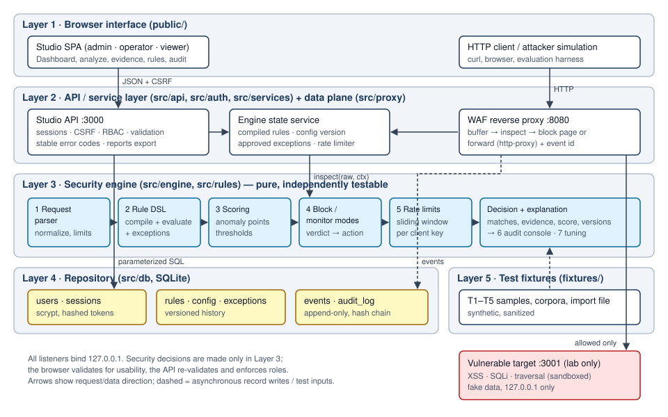

# WAF Studio — Architecture and Integration Contract

> This document is the **binding contract** between the four workstreams. It was written before any
> screens or modules, as the proposal requires ("Define the data model, roles, input schema,
> decision/result schema, and audit-event format before building screens"). If code and this document
> disagree, fix one of them and record the change in `docs/PROGRESS.md`.

## 1. System overview



Text version:

```
             ┌──────────────────────────── 127.0.0.1 only ───────────────────────────────┐
  Browser ──▶│ Studio console :3000  (public/ SPA + /api)                                 │
  (admin,    │      │  auth · authz · CSRF · validation · safe errors                     │
  operator,  │      ▼                                                                    │
  viewer)    │  Service layer ──▶ Security engine (src/engine, pure functions)            │
             │      │                    ▲                                              │
             │      ▼                    │ same engine + same compiled state            │
             │  Repository (SQLite)  ◀── WAF reverse proxy :8080 ──▶ Vulnerable target :3001│
  HTTP client ──────────────────────────▶ (http-proxy)                 (target/, lab only) │
             └────────────────────────────────────────────────────────────────────────────┘
```

Three HTTP listeners, started together by `npm start` (`src/index.js`), all bound to `127.0.0.1`:

| Listener | Default port | Env var | Purpose |
|---|---|---|---|
| Studio console (UI + API) | 3000 | `STUDIO_PORT` | Admin/operator/viewer web console and JSON API |
| WAF reverse proxy | 8080 | `PROXY_PORT` | Inspects traffic and forwards allowed requests to the target |
| Vulnerable target | 3001 | `TARGET_PORT` | Deliberately vulnerable lab app (never exposed directly in demos) |

Other env vars: `TARGET_URL` (default `http://127.0.0.1:3001`), `WAF_DATA_DIR` (default `./data`),
`WAF_DB_PATH` (default `<WAF_DATA_DIR>/waf-studio.db`), `WAF_SECRET` (optional; otherwise a random
32-byte key is generated once into `<WAF_DATA_DIR>/secret.key` with owner-only permissions).

### 1.1 Layers (proposal "Required architecture")

| # | Layer | Directory | Owner |
|---|---|---|---|
| 1 | Browser interface (validated input, explainable output) | `public/` | Wahaj |
| 2 | API / service layer (authn, authz, business rules, safe errors) | `src/api/`, `src/auth/`, `src/services/` | Shazil |
| 3 | Security engine (detection + policy logic) | `src/engine/`, `src/rules/` | Nufil |
| 4 | Repository (records + append-only audit) | `src/db/` | Shazil |
| 5 | Test fixtures (safe sample inputs) | `fixtures/` | Nufil |
| — | Reverse proxy data plane + bootstrap | `src/proxy/`, `src/index.js` | Shazil |
| — | Reports (export) | `src/reports/` | Wahaj |
| — | Vulnerable lab target | `target/` | Saad |
| — | Tests, evaluation, packaging | `test/`, `scripts/` | Saad (+ each owner writes unit tests for own code) |

Security logic never lives only in presentation code: the browser validates for usability, the server
re-validates everything, and every decision is made by `src/engine`.

### 1.2 Detailed working sequence (proposal page 2) → pipeline stages

`engine.inspect()` executes the stages in the proposal's order. Each stage receives only validated,
normalized data plus the evidence accumulated so far.

| Step | Proposal module | Implementation |
|---|---|---|
| 1 | Request parser | `engine/parser.js` — validates method, URL, headers, body size; normalizes (multi-round URL decode, HTML entity decode, Unicode NFKC, null-byte strip, path canonicalization); malformed/oversized input is rejected **before** rule evaluation |
| 2 | Rule DSL | `engine/dsl.js` (compile) + `engine/evaluate.js` (run) — compiled rules evaluated against normalized targets; produces matches with location + decoded-via evidence; approved exceptions are applied here (suppressed matches kept as evidence) |
| 3 | Scoring | `engine/scoring.js` — anomaly score = Σ rule points + parser anomaly points; per-category breakdown; compares to `flag`/`block` thresholds |
| 4 | Block/monitor modes | `engine/modes.js` — maps verdict to action: `block` mode enforces, `monitor` mode only logs (`wouldBlock: true`) |
| 5 | Rate limits | `engine/ratelimit.js` — sliding-window counter per pseudonymous client key; limit breach → 429 in block mode, logged in monitor mode |
| 6 | Audit console | Repository stores the decision event; security-relevant actions go to the append-only, hash-chained audit log; console shows them |
| 7 | Tuning & exception workflow | Operators raise exceptions from an event; admins approve (separation of duties); approved exceptions feed back into step 2; decision, explanation and evidence are shown and exportable |

## 2. Roles and authorization (enforced on the server)

| Capability | admin | operator | viewer |
|---|:-:|:-:|:-:|
| Log in / log out / change own password | ✓ | ✓ | ✓ |
| Dashboard stats, event list (summaries only) | ✓ | ✓ | ✓ |
| Event detail (evidence), compare events | ✓ | ✓ | ✗ |
| Submit / import samples, replay event | ✓ | ✓ | ✗ |
| Read rules and config, validate DSL | ✓ | ✓ | ✗ |
| Create / edit / enable / disable / delete rules | ✓ | ✗ | ✗ |
| Change mode, thresholds, limits, rate limits | ✓ | ✗ | ✗ |
| Request exception, preview impact | ✓ | ✓ | ✗ |
| Approve / reject / revoke exception (not own request) | ✓ | ✗ | ✗ |
| Audit console + chain verification | ✓ | ✗ | ✗ |
| Export reports | ✓ | ✓ | ✗ |
| Manage users | ✓ | ✗ | ✗ |

Denied requests receive a **generic** `403 FORBIDDEN` (no record content) and an `auth.denied` audit event.
High-impact actions (mode change, threshold change, disabling/deleting a rule, approving/revoking an
exception, disabling a user, changing a role) require `"confirm": true` in the body; otherwise
`428 CONFIRMATION_REQUIRED`.

## 3. Engine module interface (`src/engine/index.js`, owner Nufil)

All functions are synchronous, pure where possible, have no DB or network access, and are independently testable.

```js
const engine = require('./src/engine');
engine.ENGINE_VERSION            // e.g. '1.0.0'
engine.DEFAULT_CONFIG            // EngineConfig (below)
engine.validateConfig(cfg)       // -> { ok, config /* normalized */, errors: [{ field, message }] }
engine.parseRequest(raw, limits) // -> { ok, request: NormalizedRequest|null, anomalies: Anomaly[], error: {code,message}|null }
engine.validateRuleSource(src)   // -> { ok, rule: RuleMeta|null, errors: [{ line, col, message }] }
engine.parseRuleFile(text)       // -> { rules: [{ id, source }], errors: [...] }  (multi-rule .rules file -> one source per rule)
engine.compileRules(records)     // records: [{ id, source, enabled, version }] -> { rules: CompiledRule[], errors: [{ruleId,line,col,message}], rulesetVersion }
engine.createRateLimiter(opts)   // -> { check(key, now) -> RateLimitResult, configure(opts), reset() }
engine.inspect(raw, ctx)         // -> Decision (full pipeline, never throws on hostile input)
engine.redact(value)             // deep copy with secrets masked (authorization, cookie, set-cookie, password, token, secret, api key ...)
engine.excerpt(str, index, len)  // safe, truncated, control-char-free excerpt used in evidence
```

### 3.1 Raw request (input to `parseRequest` / `inspect`)

```js
{
  method: 'GET',                       // as received
  url: '/search?q=%27%20OR%201%3D1',   // path + raw query string, NOT decoded
  headers: { 'content-type': '...', 'user-agent': '...' },  // lower-cased names, string values
  body: Buffer | string | null,        // at most limits.inspectBodyBytes bytes are inspected
  bodyBytes: 1234,                     // total declared/received body size (for oversize decisions)
  remoteAddress: '127.0.0.1'
}
```

### 3.2 EngineConfig (`DEFAULT_CONFIG`)

```js
{
  mode: 'block',                       // 'block' | 'monitor'
  thresholds: { flag: 3, block: 5 },   // integers, 1 <= flag <= block <= 100
  limits: {
    maxBodyBytes: 1048576,             // > this → reject 413 BODY_TOO_LARGE (before rules)
    inspectBodyBytes: 65536,           // bytes inspected; remainder → anomaly BODY_PARTIALLY_INSPECTED
    maxUrlLength: 4096,                // > this → reject 414-style MALFORMED_REQUEST (status 400)
    maxHeaderCount: 100,
    maxArgs: 200,
    decodeRounds: 3                    // URL-decode passes (detects double/triple encoding)
  },
  rateLimit: { enabled: true, windowMs: 60000, maxRequests: 300 }
}
```

### 3.3 Inspect context

```js
{
  rules: CompiledRule[], rulesetVersion: 'sha256-prefix',
  config: EngineConfig, configVersion: 7,
  exceptions: Exception[],             // ONLY approved & unexpired (service layer filters)
  rateLimiter: RateLimiter | null,     // null → stage skipped (e.g. console analysis)
  clientKey: 'c_3f9a…',                // pseudonymous HMAC of IP, computed by caller
  now: Date.now()
}
```

### 3.4 Exception (tuning) shape

```js
{ id: 'exc_…', ruleId: 942100,
  scope: { pathPrefix: '/search' | null, location: 'query.q' | null, method: 'GET' | null },
  reason: '…', status: 'approved', expiresAt: ISO | null }
```

A match is suppressed when `ruleId` equals the match rule id AND every non-null scope field matches
(`path.startsWith(pathPrefix)`, `match.location === location`, `method === method`).

### 3.5 Match locations

`path`, `query.<name>`, `body.<name>` (form/JSON field, dotted for nested JSON), `body` (raw body),
`header.<name>`, `cookie.<name>`, `method`, `query_names`, `body_names`.

### 3.6 Decision (output of `inspect`, also stored per event)

```js
{
  verdict: 'allow' | 'flag' | 'block',            // engine opinion
  action: 'allowed' | 'blocked' | 'logged',       // what actually happened (monitor mode never blocks)
  wouldBlock: true,                               // verdict was block (or rate limited / rejected)
  statusCode: null | 400 | 403 | 413 | 429,       // returned to client when blocked
  blockReason: null | 'SCORE_THRESHOLD' | 'RATE_LIMITED' | 'MALFORMED_REQUEST' | 'BODY_TOO_LARGE',
  mode: 'block' | 'monitor',
  score: {
    total: 8, flagThreshold: 3, blockThreshold: 5,
    byCategory: { sqli: 5, xss: 3 },
    contributions: [ { source: 'rule' | 'anomaly', id: '942100', points: 5, reason: '…' } ]
  },
  matches: [ {
    ruleId: 942100, ruleName: 'SQLi boolean tautology', ruleVersion: 1,
    severity: 'critical', points: 5, category: 'sqli', tags: ['sqli','owasp-a03'],
    location: 'query.q', operator: 'matches',
    excerpt: "' OR 1=1",                         // ≤ 120 chars, redacted, control chars escaped
    decodedVia: ['url'],                          // normalization steps needed to reveal the match
    suppressedBy: null                            // exception id when suppressed
  } ],
  suppressed: [ /* matches suppressed by exceptions (same shape, suppressedBy set) */ ],
  anomalies: [ { code: 'DOUBLE_ENCODING', message: '…', points: 2 } ],
  rateLimit: { checked: true, limited: false, count: 4, limit: 300, windowMs: 60000 },
  request: {                                      // sanitized summary — never raw secrets
    method: 'GET', path: '/search', queryNames: ['q'], bodyNames: [],
    contentType: null, bodyBytes: 0, inspectedBytes: 0, truncated: false,
    userAgent: 'curl/8.4' /* ≤ 80 chars */
  },
  explanation: [ "Rule 942100 'SQLi boolean tautology' matched query.q after URL decoding (+5)", '…' ],
  recommendation: 'Block: input contains a SQL tautology…',
  engine: { engineVersion: '1.0.0', rulesetVersion: '…', configVersion: 7 },
  timings: { parseMs: 0.1, rulesMs: 0.4, totalMs: 0.6 }
}
```

### 3.7 Rule DSL (summary — full grammar in `docs/rule-dsl.md`, owner Nufil)

One rule per record; a `.rules` file may hold many.

```
rule 942100 "SQLi boolean tautology" {
  when args matches /\b(or|and)\b\s+['"]?\d+['"]?\s*=\s*['"]?\d+/i
  severity critical
  score 5
  category sqli
  tags sqli, owasp-a03
  description "Tautology used to bypass WHERE clauses"
}
```

Rule ids are integers 1000–999999. Targets, operators (`matches`, `contains`, `equals`, `startswith`,
`endswith`, `in`, `gt`, `lt`, …), `and`/`or`/`not` combinators and validation rules (including ReDoS
guarding of regexes) are defined by Nufil in `docs/rule-dsl.md`.

## 4. Data model (SQLite via built-in `node:sqlite`, owner Shazil)

All queries are parameterized. All ids are generated server-side (`crypto.randomUUID()` with a prefix).

| Table | Key columns |
|---|---|
| `users` | `id` (`usr_…`), `username` UNIQUE, `password_hash` (scrypt, per-user salt), `role` (admin/operator/viewer), `disabled`, `failed_attempts`, `locked_until`, `created_at`, `updated_at` |
| `sessions` | `token_hash` PK (SHA-256 of cookie token — raw token never stored), `user_id`, `csrf_token`, `created_at`, `last_seen_at`, `expires_at` |
| `rules` | `id` INTEGER PK (DSL id), `name`, `source`, `enabled`, `version`, `severity`, `category`, `updated_at`, `updated_by` |
| `rule_versions` | `rule_id`, `version`, `source`, `enabled`, `changed_by`, `changed_at`, `change` (create/update/enable/disable/delete) |
| `config_versions` | `version` PK, `config_json`, `changed_by`, `changed_at`, `reason` (latest row = active config) |
| `events` | `id` (`evt_…`), `ts`, `source` (proxy/console/import/replay), `label`, `client_id`, `method`, `path`, `verdict`, `action`, `score`, `mode`, `matched_rule_ids` (JSON), `decision_json`, `sample_json` (console only, redacted), `ruleset_version`, `config_version`, `latency_ms`, `submitted_by`, `replay_of` |
| `exceptions` | `id` (`exc_…`), `rule_id`, `path_prefix`, `location`, `method`, `reason`, `status` (pending/approved/rejected/revoked), `requested_by`, `reviewed_by`, `review_note`, `source_event_id`, `created_at`, `reviewed_at`, `expires_at` |
| `audit_log` | `seq` INTEGER PK AUTOINCREMENT, `id` (`aud_…`), `ts`, `actor_id`, `actor_name`, `actor_role`, `action`, `target_type`, `target_id`, `outcome`, `client_id`, `details_json`, `prev_hash`, `hash` — **append-only**: SQLite triggers `RAISE(ABORT)` on UPDATE and DELETE |

### 4.1 Audit event format

```js
{ seq: 42, id: 'aud_…', ts: '2026-10-19T10:00:00.000Z',
  actorId: 'usr_…' | null, actorName: 'admin' | 'anonymous' | 'system', actorRole: 'admin' | null,
  action: 'config.update', targetType: 'config', targetId: '8',
  outcome: 'success' | 'failure' | 'denied',
  clientId: 'c_…',                    // HMAC pseudonym, never the raw IP
  details: { /* redacted, no secrets, no passwords, no session tokens */ },
  prevHash: '…', hash: 'sha256(prevHash + canonicalJSON(all fields above except hash))' }
```

Audited actions (minimum): `auth.login.success`, `auth.login.failure`, `auth.logout`, `auth.lockout`,
`auth.denied`, `auth.password.change`, `config.update`, `rule.create`, `rule.update`, `rule.enable`,
`rule.disable`, `rule.delete`, `analysis.submit`, `import.submit`, `event.replay`, `exception.request`,
`exception.approve`, `exception.reject`, `exception.revoke`, `report.export`, `user.create`,
`user.update`, `system.start`, `system.error`, `request.rejected` (malformed API input).
Proxy decisions are stored in `events` (high volume); console decisions are stored in `events` **and**
produce an `analysis.submit` audit event.

### 4.2 Privacy / data minimization

* Raw IPs are never stored: `clientId = 'c_' + HMAC-SHA256(secret, ip).hex.slice(0,16)`.
* Proxy events store only the decision (sanitized request summary + ≤120-char redacted excerpts), never full bodies or header values.
* Console samples are stored redacted (`authorization`, `cookie`, password-like fields masked) so they can be replayed.
* Passwords: scrypt (N=16384, r=8, p=1, 64-byte key, 16-byte salt), compared with `timingSafeEqual`.

## 5. API contract (Studio console, owner Shazil; consumed by Wahaj's UI)

Base path `/api`. JSON in/out. Cookie session `waf_sid` (HttpOnly, SameSite=Strict, Path=/; `Secure`
when served over HTTPS). Idle timeout 30 min, absolute lifetime 8 h. Every state-changing request
(POST/PUT/PATCH/DELETE) except `POST /api/auth/login` must send header `X-CSRF-Token` equal to the
session's CSRF token (returned by login and `GET /api/auth/me`). Requests with bodies must be
`Content-Type: application/json` (else `415`). JSON body limit 256 KiB (else `413`), except
`POST /api/analyze` and `POST /api/import`, which accept 2 MiB envelopes so 1 MiB sample bodies fit.
The browser import picker separately caps selected files at 256 KiB. This final integration
clarification matches `src/api/app.js`, the API guide and the import/size tests.

### 5.1 Error format and stable codes

```json
{ "error": { "code": "VALIDATION_FAILED", "message": "Human-readable, no internals", "details": [ { "field": "username", "message": "required" } ], "requestId": "req_…" } }
```

| HTTP | code |
|---|---|
| 400 | `VALIDATION_FAILED`, `MALFORMED_JSON` |
| 401 | `AUTH_REQUIRED`, `AUTH_INVALID`, `SESSION_EXPIRED` |
| 403 | `FORBIDDEN`, `CSRF_INVALID` |
| 404 | `NOT_FOUND` |
| 409 | `CONFLICT` |
| 413 | `PAYLOAD_TOO_LARGE` |
| 415 | `UNSUPPORTED_MEDIA_TYPE` |
| 428 | `CONFIRMATION_REQUIRED` |
| 429 | `RATE_LIMITED` (body also has `retryAfterSeconds`; `Retry-After` header set) |
| 500 | `INTERNAL_ERROR` (never a stack trace) |

### 5.2 Endpoints

| Method & path | Roles | Body / query | Response |
|---|---|---|---|
| `GET /api/health` | public | — | `{ status: 'ok', version }` |
| `POST /api/auth/login` | public | `{ username, password }` | `200 { user: {id, username, role}, csrfToken, expiresAt }` + cookie. Failures: `401 AUTH_INVALID` (generic); after 5 failures/15 min per username, or 20/min per client → `429 RATE_LIMITED` |
| `POST /api/auth/logout` | any | — | `204` |
| `GET /api/auth/me` | any | — | `{ user, csrfToken, expiresAt }` |
| `POST /api/auth/password` | any | `{ currentPassword, newPassword }` (min 12 chars) | `204`; **all** of the user's sessions (including the current one) are revoked and the cookie cleared — the client must sign in again. Wrong current password → `400 VALIDATION_FAILED` on `currentPassword` |
| `GET /api/stats` | all | `?hours=24` | `{ totals: {requests, allowed, logged, blocked, flagged}, byCategory: {}, topRules: [{ruleId, name, count}], latency: {avgMs, p50Ms, p95Ms}, mode, rulesetVersion, configVersion, timeline: [{hour, allowed, logged, blocked}] }` |
| `GET /api/events` | all | `?verdict=&action=&source=&ruleId=&q=&from=&to=&limit=50&offset=0` | `{ items: EventSummary[], total }` |
| `GET /api/events/:id` | admin, operator | — | `{ event: Event }` |
| `GET /api/events/compare` | admin, operator | `?a=&b=` | `{ a: Event, b: Event, diff: { verdictChanged, actionChanged, scoreDelta, rulesAdded, rulesRemoved, rulesetChanged, configChanged } }` |
| `POST /api/analyze` | admin, operator | `{ label?, sample: Sample }` | `201 { event: Event }` |
| `POST /api/import` | admin, operator | `{ filename, samples: Sample[] }` (≤100 samples, filename must end `.json`) | `201 { imported, events: EventSummary[], rejected: [{index, code, message}] }` |
| `POST /api/events/:id/replay` | admin, operator | — (console/import events only) | `201 { event: Event, previous: EventSummary }` |
| `GET /api/rules` | admin, operator | — | `{ items: Rule[], rulesetVersion, compileErrors: [] }` |
| `GET /api/rules/:id/history` | admin, operator | — | `{ items: RuleVersion[] }` |
| `POST /api/rules/validate` | admin, operator | `{ source }` | `200 { ok, rule, errors }` |
| `POST /api/rules` | admin | `{ source, enabled }` | `201 { rule }` |
| `PUT /api/rules/:id` | admin | `{ source?, enabled?, confirm? }` (confirm required when disabling) | `200 { rule }` |
| `DELETE /api/rules/:id` | admin | `{ confirm: true }` | `204` |
| `GET /api/config` | admin, operator | — | `{ config, version, changedAt, changedBy }` |
| `PUT /api/config` | admin | `{ config: EngineConfig, reason, confirm: true }` | `200 { config, version }` |
| `GET /api/config/history` | admin, operator | — | `{ items: [{version, config, changedBy, changedAt, reason}] }` |
| `GET /api/exceptions` | admin, operator | `?status=` | `{ items: ExceptionRecord[] }` |
| `POST /api/exceptions/preview` | admin, operator | `{ ruleId, scope }` | `{ affectedEvents, sample: EventSummary[] }` (recent events the exception would have suppressed) |
| `POST /api/exceptions` | admin, operator | `{ ruleId, scope: {pathPrefix, location, method}, reason, sourceEventId?, expiresAt? }` | `201 { exception }` (status `pending`) |
| `POST /api/exceptions/:id/approve` | admin (≠ requester) | `{ confirm: true, note? }` | `200 { exception }` |
| `POST /api/exceptions/:id/reject` | admin (≠ requester) | `{ note? }` | `200 { exception }` |
| `POST /api/exceptions/:id/revoke` | admin | `{ confirm: true, note? }` | `200 { exception }` |
| `GET /api/audit` | admin | `?action=&actor=&outcome=&from=&to=&limit=&offset=` | `{ items: AuditEvent[], total }` |
| `GET /api/audit/verify` | admin | — | `{ ok, checked, brokenAt: seq|null }` |
| `GET /api/reports/export` | admin, operator | `?format=json|csv|html&from=&to=&verdict=&ids=` (≤500 ids; fetched from the repository in batches of 200) | file download (`Content-Disposition: attachment`), sanitized |
| `GET /api/users` | admin | — | `{ items: [{id, username, role, disabled, lockedUntil, createdAt}] }` |
| `POST /api/users` | admin | `{ username, password, role }` | `201 { user }` |
| `PUT /api/users/:id` | admin | `{ role?, disabled?, password?, confirm? }` | `200 { user }` |

**Sample** (console input schema):

```js
{ method: 'GET'|'POST'|'PUT'|'PATCH'|'DELETE'|'HEAD'|'OPTIONS',
  path: '/search?q=hello',                 // must start with '/', ≤ 4096 chars
  headers: { 'content-type': '…' },        // ≤ 50 entries, names [A-Za-z0-9-], values ≤ 4096 chars
  body: 'string' | null }                  // ≤ 1 MiB (larger → 413 handled by engine evidence when submitted via proxy)
```

**EventSummary**: `{ id, ts, source, label, method, path (≤200 chars), verdict, action, score, mode, matchedRuleIds, latencyMs }`
**ExceptionRecord**: `{ id, ruleId, scope: {pathPrefix, location, method}, reason, status, requestedBy (username), requestedById, reviewedBy, reviewNote, sourceEventId, createdAt, reviewedAt, expiresAt }`

*Integration amendments (master, after first integration):* the authenticated user is exposed to routers as `req.auth.user`;
list responses also echo `limit`/`offset`; matches may carry `locations[]` (all locations where the rule matched);
the decision request summary may include `normalizedPath`. Separation of duties applies to both approve **and** reject.
**Event**: EventSummary + `{ decision: Decision, sample: Sample|null, rulesetVersion, configVersion, clientId, submittedBy, replayOf }`

Viewers only ever receive EventSummary objects.

## 6. Reverse proxy behaviour (owner Shazil)

1. Buffer the request body up to `maxBodyBytes + 1` (stop reading beyond that); build the raw request; call `engine.inspect` with the shared compiled state and rate limiter.
2. Store the decision as an event (`source: 'proxy'`).
3. If `action === 'blocked'`: respond with `decision.statusCode` and a small HTML (or JSON when `Accept` prefers JSON) block page showing the event id only — rule details are **not** revealed to the client. Headers `X-WAF-Event-Id`, `X-WAF-Action`.
4. Otherwise forward with `http-proxy` (buffered body re-streamed), add `X-WAF-Event-Id`, `X-WAF-Action` (`allowed`/`logged`) to the response.
5. Target unavailable → `502` safe page, `system.error` audit event.
6. Proxy-level rules, config and exceptions are reloaded immediately after any change made through the API (`services/engineState.js`).

## 7. Vulnerable target (owner Saad)

`target/app.js` exports `createTargetApp()` (Express app); `target/server.js` starts it standalone.
Deliberately vulnerable **only within its own sandbox**: reflected/stored XSS, SQL injection against an
in-memory throwaway SQLite DB of fake users, path traversal that can only reach fake files under
`target/` (resolved-path guard keeps it away from the real filesystem), large-body echo, health. Binds to
127.0.0.1 and contains only fake data.

## 8. Reports (owner Wahaj)

`src/reports/export.js` exports `buildReport({ events, stats, config, rulesetVersion, generatedBy, filters }, format)`
→ `{ filename, contentType, body }` for `json`, `csv` and `html`. All content is sanitized (HTML-escaped,
CSV formula-injection-safe by prefixing `'` to cells starting with `= + - @`, redacted excerpts only).
Route `src/api/routes/reports.js` is owned by Wahaj and mounted by Shazil's router.

## 9. Directory layout and ownership

```
package.json, package-lock.json, .gitignore ............ master (do not edit; ask master for deps)
README.md ............................................... Saad
src/index.js, src/config.js ............................. Shazil
src/db/**, src/auth/**, src/services/**, src/proxy/** .... Shazil
src/api/** (except routes/reports.js) ................... Shazil
src/api/routes/reports.js, src/reports/** ............... Wahaj
src/engine/**, src/rules/** ............................. Nufil
fixtures/** ............................................. Nufil
public/** ............................................... Wahaj
target/** ............................................... Saad
scripts/setup.js, scripts/reset.js ...................... Shazil (seeding users, default rules, default config)
scripts/** (all other scripts) .......................... Saad
docs/diagrams/** ........................................ Saad (DFD) and master (architecture)
test/unit/engine/** ..................................... Nufil
test/unit/{db,auth,api}/** .............................. Shazil
test/unit/reports/**, test/unit/ui/** ................... Wahaj
test/integration/**, test/security/**, test/evaluation/** Saad
docs/progress/<member>.md ............................... each member
```

## 10. Conventions

* Node ≥ 22.13 (built-in `node:sqlite`, `node:test`); CommonJS modules; no new runtime dependencies.
* Every module exports factories (`createX(deps)`) so tests can run on ephemeral ports and `:memory:` DBs.
* `src/index.js` exports `startAll(options) → { studio, proxy, target, close() }` and also runs when executed directly.
* Server-side factories: `createStudioApp({ db, engineState, secret, logger })`, `createProxyServer({ db, engineState, targetUrl, secret })`, `openDatabase(path)`.
* No `console.log` of secrets, tokens or passwords. No stack traces in responses.
