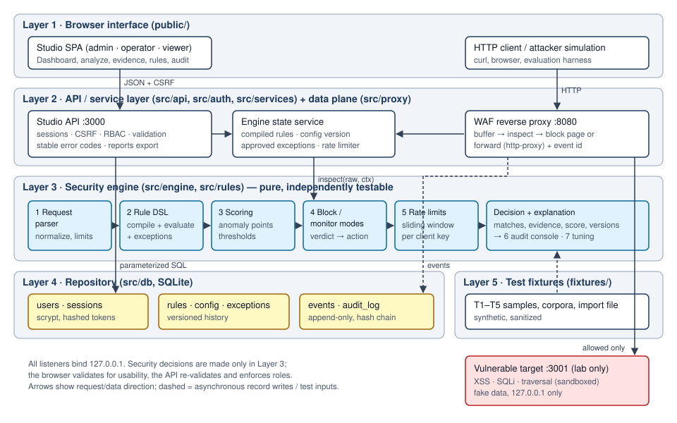
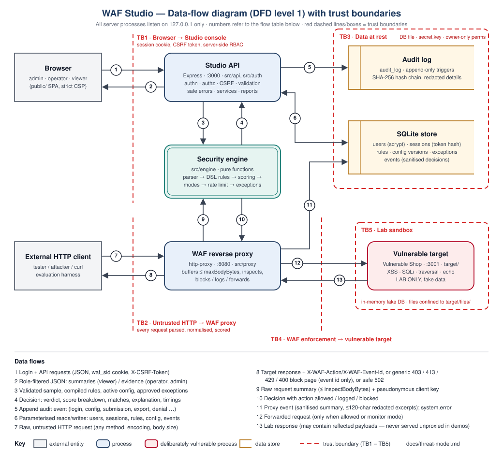

# WAF Studio - Final Project Report

**Proposal 44 | Class 3, Group 12**  
**Domain:** Web and Infrastructure Security  
**Workstreams:** Shazil (A), Nufil (B), Wahaj (C), Saad (D)  
**Final integration:** 20 October 2026, Asia/Karachi; results re-measured 25 November 2026

## 1. Executive summary

WAF Studio is a local reverse-proxy Web Application Firewall that explains its decisions. It protects
a deliberately vulnerable shop, supplies a browser console for three roles, stores decisions and
versioned policy in SQLite, and exports sanitized evidence. Its engine implements a validated rule
language, normalization, anomaly scoring, block/monitor modes, sliding-window rate limits and scoped
exceptions. The default set contains 41 rules. The architecture and interfaces established during
Claude's four workstreams were retained during final integration; runtime detection code was not
rewritten in this completion. On 25 November 2026 two default rules (942100, 942110) were extended to catch hexadecimal-literal and `||` concatenation tautologies, the console gained a command menu and safe retries backed by API idempotency keys, and two dependency advisories were patched; every figure below comes from the re-measurement after those changes.

The final strict acceptance run passed **804 of 804 automated tests (100%)**, with no failed, skipped
or cancelled tests. The production dependency audit reported **zero vulnerabilities**. These figures
are recorded in [the acceptance summary](evaluation/check-summary.json), not inferred from an earlier
phase-1 run.

The complete mandatory evaluation produced **119 passes from 123 checks (96.7%)**. T1, T2, T3, T4,
T6 and T-final all passed. T5 blocked 14 of 18 bypass attempts (up from 12 before the 25 November rule fix), retaining four misses as failed
protection expectations. A separate controlled corpus of 80 adverse and 68 benign requests produced
77 true positives, three false negatives, 68 true negatives and zero false positives: 96.25% recall,
100% precision, and 0% observed false-positive rate. Corpus engine decision latency was 0.277 ms at
p95. See [the full per-input evaluation](evaluation/results.md) and [machine-readable evidence](evaluation/results.json).

In a separate localhost benchmark, p95 added proxy latency was **1.721 ms for GET** and **1.886 ms for
a 2 KiB form POST**, both below the 25 ms teaching-tool target. These results describe one controlled
synthetic experiment on one laptop, not production security or performance guarantees. Evidence:
[latency measurements](evaluation/latency.json).

All requested source, documentation, evaluation and report deliverables are present. The proposal's
separate **10-15 minute demonstration is excluded at the user's explicit instruction** on 20 October
2026. No walkthrough or demo artifact is supplied. This exception is recorded in the
[project plan](00-project-plan.md) and [traceability matrix](traceability.md).

## 2. Problem, scope and requirements

The proposal asks for a functioning system that accepts controlled input, makes an explainable
security decision, retains reproducible evidence and protects its own users and data. A design-only
mock-up would not meet that objective. WAF Studio therefore exposes both a real HTTP reverse proxy
and a console analysis workflow using the same security engine and active policy.

The seven required functional modules are request parsing, rule DSL, scoring, block/monitor modes,
rate limits, audit console, and tuning/exceptions. The proposal's acceptance paragraph says "six",
but its explicit FR-1 through FR-7 list contains seven; all seven are implemented and mapped in
[traceability](traceability.md). The detailed requirements are in [the requirements document](01-requirements.md).

In scope are the responsive web console, local API, persistent store, security engine, evidence view
and exportable reports. Production hosting, paid services, native mobile development, external
targets and real-world attack deployment remain out of scope. Every listener binds to 127.0.0.1.
The test shop contains fake users, fake products and fake secret files; its deliberate vulnerabilities
are bounded by an in-memory database and a filesystem sandbox. Evidence for those boundaries is in
`test/integration/target.test.js` and `test/security/errors-headers.test.js`.

## 3. Architecture and data flow



**Figure 1.** The browser/API path and proxy path share the engine, policy state and repository.
The complete interface contract is [architecture and integration](02-architecture.md).

| Layer | Responsibility | Principal source |
|---|---|---|
| Browser | Validated input, history, explainable evidence and role-aware controls | `public/` |
| API/services | Authentication, authorization, CSRF, validation, versioned changes and safe errors | `src/api/`, `src/auth/`, `src/services/` |
| Security engine | Pure inspection functions, normalized variants, rules, scoring and exceptions | `src/engine/`, `src/rules/` |
| Repository | SQLite records, policy versions, sessions and append-only audit chain | `src/db/` |
| Fixtures | Safe, synthetic benign/adverse inputs and body-size generator | `fixtures/` |

`npm start` launches the console at :3000, proxy at :8080 and target at :3001. Console analysis is
authenticated and role-restricted. The protected HTTP interface accepts traffic and applies the WAF
without requiring the traffic sender to have a console account; proxy inspection and console
authorization are separate concerns. The proxy buffers a bounded body, inspects it, stores an event
and either returns a block response or forwards the request. Upstream failure produces a safe 502;
an unexpected inspection exception fails closed with 503. The proxy block page exposes an event ID,
not the detailed detection rule. Tests: `test/integration/proxy.test.js` and `test/unit/api/proxy.test.js`.

## 4. Security engine and explainability

### 4.1 Parsing and normalization (FR-1)

The parser validates method, URL, header/argument count and body size, then extracts query, JSON,
form, multipart, cookie and other supported values. It retains multiple normalized variants and
records the transformations needed for a match. Transformations include repeated URL decoding,
%u escapes, HTML entities, Unicode NFKC, null/invisible-character removal, SQL comment handling,
whitespace/case normalization and backslash/path handling. The record's `decodedVia` evidence makes
an encoded match explainable. Tests: `test/unit/engine/parser.test.js`, `attack-fixtures.test.js`;
evaluation T2.

Defaults are a 4,096-character URL, 100 headers, 200 arguments, three decode rounds, a **64 KiB
inspection window**, and a **1 MiB maximum body**. Bodies above 1 MiB are rejected with 413. A body
between 64 KiB and 1 MiB can be forwarded with only its prefix inspected and an explicit
`BODY_PARTIALLY_INSPECTED` anomaly. T4 measures the resulting blind spot. Malformed percent encoding
is reported as an anomaly; it is not automatically rejected in every case (TF-02 was 200/allowed).

### 4.2 Rule DSL and scoring (FR-2, FR-3)

Rules specify an ID, name, condition, severity, points, category, tags and explanation. The parser
rejects invalid syntax with line/column errors and rejects unsafe regex patterns using a conservative
guard. Administrators validate and version changes through the API. No additional runtime dependency
was introduced. Grammar, targets, operators and examples are in [the DSL reference](rule-dsl.md).
Tests: `test/unit/engine/dsl.test.js`, `rules.test.js` and `test/unit/api/api.test.js`.

Each matching rule contributes once per request, with the matched location, excerpt and decoding
steps preserved. Default thresholds are **flag 3** and **block 5**; anomaly points are included in the
total. Decisions retain contributions, category totals, thresholds, rule/config/engine versions,
timings, explanations and a recommendation. Tests: `test/unit/engine/scoring-modes.test.js` and
`test/integration/workflow.test.js`; per-input examples are in [evaluation results](evaluation/results.md).

### 4.3 Modes, limits and tuning (FR-4, FR-5, FR-7)

Block mode enforces the adverse decision; monitor mode logs `wouldBlock` while forwarding. The proxy
still rejects bodies it cannot fully buffer above the maximum size, even in monitor mode. The
sliding-window proxy limiter defaults to 300 requests per 60 seconds per client pseudonym. Login
uses separate per-account and per-client throttles; repeated console analysis is also limited.
Tests: `test/integration/proxy.test.js`, `test/security/login-protection.test.js`; TF-08 and TF-09.

Operators can preview and request an exception scoped to path, method and location. A different
administrator must review it; an operator cannot approve it. A replay creates a new event, preserves
the original and records suppressed matches with the exception identifier. Revoke restores the
original enforcement. Confirmation is required for high-impact configuration changes. Tests:
`test/integration/exceptions.test.js`, `workflow.test.js`, `test/unit/engine/exceptions.test.js`.

### 4.4 Audit, history and reports (FR-6)

The console provides filterable history, evidence detail, side-by-side comparison and sanitized
JSON/CSV/HTML export. Audit entries record actor, action, target, outcome, timestamp, previous hash
and current hash. SQLite triggers reject audit UPDATE/DELETE operations, and verification locates
the first broken link. This detects ordinary tampering but does not prevent a local filesystem
administrator from rewriting an entire unanchored chain. Tests:
`test/security/audit-integrity.test.js`, `test/unit/reports/*.test.js` and `test/integration/workflow.test.js`.

## 5. Application security and threat model



**Figure 2.** Five trust boundaries and 13 numbered flows. The complete
[STRIDE model](threat-model.md) maps **20 threats** to mitigation, implementation, tests and residual risk.

| Security decision | Reason | Verification |
|---|---|---|
| Server-enforced admin/operator/viewer roles | UI visibility alone cannot protect records or changes | `test/security/authorization.test.js` |
| scrypt hashes and hashed session tokens | Reduce exposure of passwords and reusable tokens in the database | `test/unit/auth/auth.test.js`, `test/security/secrets.test.js` |
| 30-minute idle / 8-hour absolute expiry; CSRF-bound session | Bound session lifetime and protect authenticated state changes | `test/security/session-csrf.test.js` |
| Parameterized SQL, generated IDs and strict schemas | Prevent application SQL injection and untrusted identifiers/structure | `test/security/injection-output.test.js`, `import-validation.test.js` |
| Text-only DOM construction, strict CSP, escaped HTML and CSV exports | Adverse samples must be displayable without attacking the console or spreadsheet reader | `test/unit/ui/static-security.test.js`, `test/unit/reports/export.test.js` |
| Redaction and HMAC client pseudonyms | Keep credentials, cookie values and raw IPs out of retained evidence | `test/security/secrets.test.js` |
| Bounded target filesystem and in-memory fake SQL database | Demonstrate vulnerabilities without exposing host files or persistent user data | `test/integration/target.test.js` |

JSON request bodies are limited to 256 KiB generally; analyze/import accept 2 MiB envelopes so a
1 MiB sample can fit. The browser import picker uses a more conservative 256 KiB file limit. This
integration clarification is recorded in [the API guide](api.md) and [master progress](PROGRESS.md).

All current security suites pass. No unresolved critical authorization, application injection,
secret-exposure or unsafe-file-handling findings were identified by the automated checks. This is
an evidence-bounded statement, not a claim that the application has no undiscovered vulnerabilities.
The dependency audit covers installed production dependencies at its recorded timestamp, not
future advisories or the runtime/browser themselves.

## 6. Evaluation method and reproducibility

Evaluation starts the full stack on ephemeral localhost ports with a new temporary database. It
sends fixture requests through the real proxy, retrieves their stored events via an authenticated
API client, and records input, expected/actual result, matched rules, score, decoding/anomalies,
explanation and pass/fail. The temporary DB is removed afterwards; saved event IDs identify records
within the generated evidence, not records available in the normal running application's database.

The environment was **Node v24.19.0**, Windows build **10.0.26300**, Intel Core Ultra 7 255H,
16 logical CPUs and approximately 31 GiB RAM as reported by Node. Engine version was **1.0.0**,
with **41 rules** and ruleset **96ab725577dc312f**. Baseline thresholds were flag 3/block 5.
The evaluation raised the proxy limit to 100,000/minute for throughput measurements, then
deliberately lowered it for TF-08. Source: `environment` and `stack` in [results JSON](evaluation/results.json).

The final evaluation timestamp is **2026-10-19T20:03:48.579Z** (20 October in Asia/Karachi).
The acceptance and independent benchmark timestamps are stored in their respective JSON files.
Commands from the repository root:

```bash
npm ci
npm run fixtures:build
npm run check
npm run evaluate
npm run bench
npm run docs:pdf
```

The fixture generator only writes synthetic JSON. It neither executes payloads nor sends requests.
Expectations were set as protection goals before measurement and remain `block` for bypass misses.
The automated fixture tests check baseline detection and require every observed miss to be triaged;
they do not relabel it benign. Details: [fixture guide](fixtures.md) and
`test/unit/engine/attack-fixtures.test.js`.

## 7. Results

### 7.1 Automated acceptance

| Measure | Result | Evidence |
|---|---|---|
| Tests / passed / failed | 804 / 804 / 0 | [check summary](evaluation/check-summary.json) |
| Suites; skipped / cancelled / todo | 39; 0 / 0 / 0 | Same summary |
| Pass rate; required minimum | 100%; 80% | Same summary |
| Production dependency vulnerabilities | 0 (including high and critical) | `npmAudit` in same summary |

These 804 regression tests are distinct from the 123 mandatory evaluation checks and 148 corpus
observations. Passing the regression suite does not mean every attempted bypass was blocked.

### 7.2 Mandatory cases

| Case | Coverage | Passed / total | Interpretation |
|---|---|---|---|
| T1 | 10 SQLi, 10 XSS and 8 traversal strings | 28/28 | All blocked with intended category evidence |
| T2 | Encoding/normalization variants | 20/20 | All blocked; malformed-byte case retains other visible traversal indicators |
| T3 | Difficult benign inputs | 38/38 | All allowed |
| T4 | Body-size and inspection boundaries | 6/6 | Expected size policy and documented beyond-window blind spot observed |
| T5 | Evasion attempts | 14/18 | Four protection failures retained and explained below |
| T6 | GET and 2 KiB POST overhead | 2/2 | Both below the 25 ms p95 threshold |
| T-final | Malformed input, denial, repetition, failure and restart | 11/11 | Safe behaviour and persisted state verified |
| Total | Mandatory checks only | 119/123 (96.7%) | Includes failed T5 expectations |

Evidence for every row and every input: [evaluation results](evaluation/results.md) and
[results JSON](evaluation/results.json). T4 includes 10/60 KiB benign bodies forwarded intact,
a 200 KiB body with its adverse suffix uninspected, an adverse prefix blocked, a 2 MiB body rejected,
and the 1 MiB boundary not rejected for size.

T-final observed a 400 oversized URL, an allowed malformed-encoding request with anomaly evidence,
400 malformed API JSON, 413 oversized JSON, 401 anonymous access, 403 protected viewer actions,
429 proxy/login throttles, safe 502 on target failure, and successful restart on the same DB.
On restart, all 41 rules, config version 4 and 936 events persisted; the audit chain verified and
SQLi remained blocked while benign traffic was allowed. Those counts belong to this measured run.

### 7.3 Corpus coverage and errors

| Metric | Value |
|---|---|
| Adverse / benign requests | 80 / 68 |
| TP / TN / FP / FN | 77 / 68 / 0 / 3 |
| Precision | 1.0000 |
| Recall | 0.9625 |
| F1 | 0.9809 |
| Observed false-positive rate | 0/68 = 0% |
| Adverse requests actually blocked | 77/80 |
| Engine decision mean / p50 / p95 / p99 | 0.147 / 0.126 / 0.277 / 0.452 ms |

SQLi category coverage was 25/27 (92.6%), XSS 24/25 (96%), traversal 16/16, command signatures 8/8
and scanners 4/4. Categories here are the intended class of each controlled input. Full values,
including all false-negative records, appear under `metrics` in [results JSON](evaluation/results.json).

The corpus shares signature families with T1/T2/T5. It is small, synthetic and intentionally
constructed; it is not an independent holdout, and the percentages must not be generalized to
Internet traffic. Some bypass inputs require application-specific interpretation that the bundled
shop does not implement. They test the WAF's coverage boundary, not successful exploitation.

### 7.4 Latency overhead

The independent benchmark used 300 interleaved request pairs per scenario after 30 warmups.
Proxy timing includes inspection, event storage and forwarding. Overhead is the difference between
the proxy and direct distributions' corresponding statistics (not the percentile of paired
differences); see `test/evaluation/latency.js`.

| Scenario | Direct p95 | Via-WAF p95 | Added p95 | Target |
|---|---|---|---|---|
| GET search | 0.317 ms | 2.038 ms | 1.721 ms | <25 ms: pass |
| POST 2 KiB form | 0.238 ms | 2.124 ms | 1.886 ms | <25 ms: pass |

There were no request errors. The evaluation's separate T6 run measured 1.674 ms and 2.154 ms
added p95 respectively, also passing. These are different runs, not contradictory measurements;
localhost scheduling and cache state vary. Sources: [benchmark](evaluation/latency.json),
T6 in [evaluation JSON](evaluation/results.json). No concurrency or production throughput claim is made.

## 8. Findings and residual limitations

The phase-1 single-parent traversal gap was fixed before Claude stopped: rule 930105 now scores 5
and the current proxy/engine tests pass. The secret-query redaction defect was also fixed and
rechecked by the current security suite. The report and threat model no longer list either as open.
Tests: `test/unit/engine/rules.test.js`, `test/integration/proxy.test.js`, `test/security/secrets.test.js`.

| Evaluation IDs | Observed miss | Boundary / interpretation |
|---|---|---|
| T5-13; CA-077 | SQL tokens split across parameters | Context-free per-value matching cannot model an application joining values |
| T5-14; CA-078 | SQL tokens split across JSON fields | Requires application data-flow reconstruction |
| T5-15; CA-079 | Base64-wrapped markup | Arbitrary application-level base64 is not decoded |
| T5-18 | Markup split across duplicate parameters | Joining behaviour depends on the protected application |

All four remain expected `block` and measured `allow`. Two former misses, T5-16 (hexadecimal numeric comparison, CA-080) and T5-17 (string-concatenated comparison), were closed on 25 November 2026 by extending rules 942100 and 942110; unit tests (`test/unit/engine/tautology-variants.test.js`) and end-to-end proxy tests (`test/integration/tautology-proxy.test.js`) cover them together with benign look-alikes, and the benign corpus still produced zero false positives. They are accepted signature-coverage
limitations for this teaching scope, with failures visible in [the evaluation](evaluation/results.md).
They do not establish that the Studio API is vulnerable to SQL injection or that the target sandbox
can be escaped; those separate properties have their own passing security tests.

Other boundaries are the 64 KiB body inspection window, synchronous heuristic regex guarding,
in-memory rate-limit windows, no response inspection, no TLS on loopback, pattern-based secret
redaction and no externally anchored audit chain. Replaying redacted samples may differ when the
original adverse value was in a secret field. The deliberately vulnerable target is directly
reachable by other local processes. The complete statement is [limitations and ethics](limitations-and-ethics.md).

## 9. Installation, use and recovery

Use Node.js 22.13 or newer; this completion was verified on Node 24.19.0. Run `npm ci`,
`npm run setup`, save the initially printed passwords, then `npm start`. Open the console at
http://127.0.0.1:3000 and send protected lab traffic to http://127.0.0.1:8080. The target is on
:3001. Setup is idempotent; it creates admin, admin2, operator and viewer accounts and seeds policy.
Generated passwords and keys are runtime data, not submission material.

The [setup guide](setup-guide.md) includes Windows commands, configuration and troubleshooting;
the [user guide](user-guide.md) and [administrator guide](admin-guide.md) explain the role-specific
screens. Back up the runtime data directory while stopped. `npm run reset -- --yes` is destructive
recovery for disposable local state; rerun setup afterwards. Ordinary persistence and restart are
verified by TF-11. Do not expose the lab to the network or use its fixtures against external targets.

## 10. Workstream integration and delivery

| Assigned workstream | Delivered responsibility |
|---|---|
| Shazil - A | Config, repository, auth, services/API, proxy, setup/reset and backend tests/guides |
| Nufil - B | Security engine, default rules, fixtures, engine tests and DSL/engine documentation |
| Wahaj - C | Responsive console, safe DOM helpers, reports, UI/report tests and user/admin guides |
| Saad - D | Vulnerable target, integration/security suites, harness, benchmark/PDF/check tooling, threat model and QA docs |
| Integration continuation | Missing adverse fixtures, measured final runs, reconciled documentation, traceability and final report/PDF |

These names retain the workstream labels in Claude's plan; the logs document automated agent work,
not independent evidence that each human team member personally authored or rehearsed every part.
Each member should understand the system before assessment. Historical UI/browser verification is
recorded in [Wahaj's progress](progress/wahaj.md); this completion reran the automated tests and
evaluation. The later dashboard refinement was reviewed live at desktop and phone widths, as recorded in the UI review evidence.

Source, fixtures, setup guide, architecture/DFD, 20-threat model, test plan/results, user/admin
guides, ethics statement, final report and traceability are delivered. The only requested scope
exception is the separate demonstration, omitted at the user's instruction. The full
[delivery matrix](traceability.md) identifies every requirement, implementation, verification and artifact.

## 11. Evidence index

UI refinement on 20 October: the dashboard now presents three outcome cards with subordinate
flagged/monitor counts, one global protection indicator, grouped role-aware navigation and five
recent inspections filtered to the same time range. Detailed rules, versions and latency remain
available through keyboard-accessible disclosure controls. Live browser review at 1440px and 390px
confirmed the revised layout and navigation with no page overflow or logged browser errors.
Screenshots and checks are in [UI review evidence](evaluation/ui-review.json). The security engine
and evaluation fixtures are unchanged, so the measured T1-T6/corpus results above remain the
recorded experiment; the acceptance suite was rerun after the UI refinement.

| Evidence | Purpose |
|---|---|
| [Requirements](01-requirements.md), [architecture](02-architecture.md) | Design and interface contract |
| [Traceability](traceability.md) | All objectives, FRs, NFRs, evaluations and delivery mapping |
| [Threat model](threat-model.md), [security controls](security-controls.md) | Security rationale, tests and residual risks |
| [Fixture guide](fixtures.md), `../fixtures/` | Synthetic reproducible inputs and expected outcomes |
| [Test plan](test-plan.md), [final test results](test-results.md) | Strategy and final interpretation |
| [Acceptance summary](evaluation/check-summary.json) | Strict test counts and dependency audit |
| [Per-input evaluation](evaluation/results.md), [JSON](evaluation/results.json) | Input, expected/actual, evidence and pass/fail |
| [Latency JSON](evaluation/latency.json) | Independent direct/proxy timing distributions |
| [Master progress](PROGRESS.md), [workstream logs](00-project-plan.md) | Handover boundary and integration amendments |

The original three-page source proposal is retained in the repository root as
`Copy of 44_Class_3_Group_12_WAF_Studio_Learning_Web_Application_Firewall.pdf`.
All reported results above come from the linked project evidence. No external security benchmark
or independent penetration-test result is claimed.
