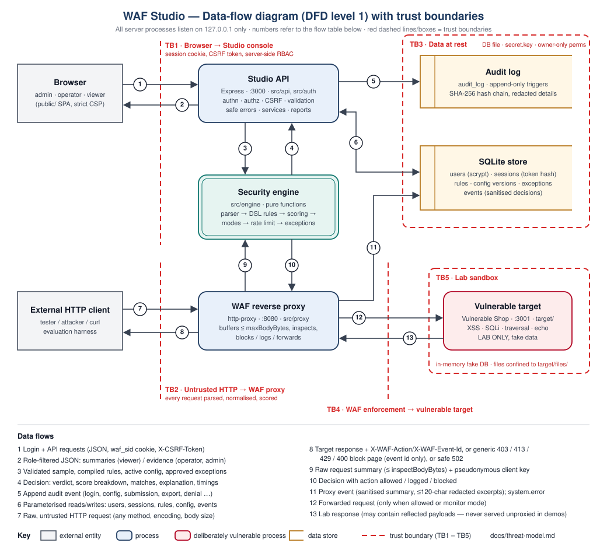

# WAF Studio — Threat Model

> Owner: Saad (member D). Method: data-flow diagram + trust boundaries + STRIDE per element/flow.
> Every threat is mapped to a mitigation, the file(s) that implement it, and the automated test that
> verifies it. The proposal asks for at least eight threats; this model covers **20**.
> Related: [architecture contract](02-architecture.md), [test plan](test-plan.md),
> [limitations and ethics](limitations-and-ethics.md).

## 1. System description

WAF Studio is a **local, explainable reverse-proxy Web Application Firewall** built for teaching. Three
HTTP listeners are started together by `npm start` (`src/index.js`), all bound to **127.0.0.1**:

| Listener | Port | Purpose |
|---|---|---|
| Studio console (UI + JSON API) | 3000 | Administrators, operators and viewers sign in, analyze samples, review evidence, tune rules, approve exceptions, read the audit log, export reports |
| WAF reverse proxy | 8080 | Every HTTP request is parsed, normalised, scored by the rule engine and then blocked, logged or forwarded |
| Vulnerable target ("Vulnerable Shop") | 3001 | A **deliberately vulnerable** lab application (XSS, SQLi, path traversal, large-body echo) that the WAF protects |

The security engine (`src/engine/`) is a set of pure functions shared by the console (sample analysis)
and the proxy (live traffic). State (users, sessions, rules, configuration versions, events, exceptions
and the append-only audit log) lives in one SQLite file (`data/waf-studio.db`, built-in `node:sqlite`).
A 32-byte secret (`data/secret.key` or `WAF_SECRET`) keys the HMAC used to pseudonymise client IPs.

## 2. Assets

| # | Asset | Why it matters | Where |
|---|---|---|---|
| A1 | Console credentials (password hashes) | Account takeover → full control of the WAF | `users` table (scrypt) |
| A2 | Session tokens and CSRF tokens | Session hijack → act as an admin | cookie `waf_sid`; `sessions` table stores only SHA-256 of the token |
| A3 | WAF policy: rules, thresholds, mode, rate limits, exceptions | Weakening it silently disables protection | `rules`, `rule_versions`, `config_versions`, `exceptions` |
| A4 | Decision evidence (events) | Needed to reproduce and justify decisions; may contain fragments of attack traffic | `events` (sanitised summaries, ≤120-char redacted excerpts) |
| A5 | Audit log | Accountability and non-repudiation of admin/operator actions | `audit_log` (append-only, hash-chained) |
| A6 | Secret key | Lets an attacker de-pseudonymise client ids / forge HMACs | `data/secret.key` |
| A7 | Exported reports | Leave the system — must be sanitised | JSON / CSV / HTML downloads |
| A8 | Availability of the proxy | If it dies, protected traffic stops (fail closed with 502) | `src/proxy/server.js` |
| A9 | The host running the lab | The deliberately vulnerable target must never become a path to the real machine | `target/` |

## 3. Actors

| Actor | Trust | Capabilities |
|---|---|---|
| Administrator | Trusted, authenticated | Everything, including policy changes, user management, exception approval, audit console |
| Operator / analyst | Partly trusted, authenticated | Analyze/import/replay, see evidence, request exceptions, export |
| Viewer | Low trust, authenticated | Dashboard and event **summaries** only |
| Anonymous browser user | Untrusted | Login page and `/api/health` only |
| External HTTP client (tester, attacker, evaluation harness) | Untrusted | Any request to the proxy on :8080 |
| Local malicious process / person with file access | Out of scope for prevention, in scope for **detection** (audit-chain verification) | Could read/modify files under `data/` |

## 4. Data-flow diagram and trust boundaries



ASCII fallback (same numbering as the SVG; ┆ = trust-boundary line):

```text
        TB1 browser → studio (cookie, CSRF, RBAC)
                   ┆                                   ┌── TB3 data at rest ─────────────────────┐
┌───────────────┐  ┆   ┌────────────────────┐          │  ┌────────────────────────────────────┐ │
│ Browser       │──1──▶│ Studio API :3000   │──────5─────▶│ Audit log: append-only, chained    │ │
│ admin/op/view │◀──2──│ authn·authz·CSRF   │          │  └────────────────────────────────────┘ │
└───────────────┘  ┆   │ validation·errors  │──┐       │                                         │
                   ┆   └────────────────────┘  │       │  ┌────────────────────────────────────┐ │
                   ┆        3          4       └───6─────▶│ SQLite: users, sessions, rules,    │ │
                   ┆        ▼          ▲         ┌──11───▶│ config, exceptions, events         │ │
                   ┆   ┌────────────────────┐    │     │  └────────────────────────────────────┘ │
                   ┆   │ Security engine    │    │     │                                         │
                   ┆   │ parse→rules→score  │    │     └─────────────────────────────────────────┘
                       └────────────────────┘    │
                   ┆        9          10        │ ┆   ┌── TB5 lab sandbox ──────────────────────┐
                   ┆        ▲          ▼         │ ┆   │                                         │
┌───────────────┐  ┆   ┌────────────────────┐    │ ┆   │  ┌────────────────────────────────────┐ │
│ External HTTP │──7──▶│ WAF proxy :8080    │────┘ ┆   │  │ Vulnerable target :3001            │ │
│ client        │◀──8──│ http-proxy         │────12──────▶│ fake in-memory DB,                 │ │
└───────────────┘  ┆   │ block/log/forward  │◀────13──────│ files only in target/files/        │ │
                   ┆   └────────────────────┘      ┆   │  └────────────────────────────────────┘ │
                   ┆                               ┆   │                                         │
                   ┆                               ┆   └─────────────────────────────────────────┘
                   ┆                               ┆
      TB2 untrusted HTTP → WAF proxy          TB4 WAF → vulnerable target
```

### 4.1 Trust boundaries

| ID | Boundary | What crosses it | Controls at the boundary |
|---|---|---|---|
| TB1 | Browser → Studio console | Credentials, API calls, role-filtered results | scrypt login, lockout + rate limit, HttpOnly/SameSite=Strict session cookie, CSRF token, server-side RBAC on every route, JSON-only bodies with size limits, strict CSP, safe errors |
| TB2 | Untrusted HTTP client → WAF proxy | Arbitrary requests (any method, encoding, size) | Body buffered only up to `maxBodyBytes + 1`, URL/header/arg limits, multi-round normalisation, rule scoring, per-client rate limit, generic block page |
| TB3 | Processes → data at rest | SQL reads/writes, audit appends, secret key | Parameterised SQL only, server-generated ids, append-only triggers + SHA-256 hash chain, redaction before storage, no raw IPs, owner-only file permissions (best effort on Windows) |
| TB4 | WAF → vulnerable target | Only requests the engine allowed (or monitor mode) | Enforcement point; target is never exposed beyond 127.0.0.1; demos and evaluation go through :8080 |
| TB5 | Vulnerable target → host | SQL against the lab DB, file reads | In-memory throw-away DB with fake data, `prepare()` (single statement), extensions disabled; file reads confined to `target/files/` by resolved-path + realpath guard; no outbound network calls |

### 4.2 Data flows

| # | From → To | Data | Boundary |
|---|---|---|---|
| 1 | Browser → Studio | Login, API requests (`waf_sid`, `X-CSRF-Token`) | TB1 |
| 2 | Studio → Browser | Role-filtered JSON (summaries for viewers, evidence for operators/admins) | TB1 |
| 3 | Studio → Engine | Validated sample, compiled rules, config, approved exceptions | — |
| 4 | Engine → Studio | Decision (verdict, score breakdown, matches, explanation, timings) | — |
| 5 | Studio → Audit log | Audit event (actor, action, outcome, redacted details) | TB3 |
| 6 | Studio ↔ SQLite | Users, sessions, rules, config, events, exceptions | TB3 |
| 7 | Client → Proxy | Raw untrusted request | TB2 |
| 8 | Proxy → Client | Target response with `X-WAF-Action` / `X-WAF-Event-Id`, or 400/403/413/429 block page (event id only), or safe 502 | TB2 |
| 9 | Proxy → Engine | Raw request summary (≤ `inspectBodyBytes`) + pseudonymous client key | — |
| 10 | Engine → Proxy | Decision + action | — |
| 11 | Proxy → SQLite / Audit | Proxy event (sanitised); `system.error` when the target is down | TB3 |
| 12 | Proxy → Target | Forwarded request (allowed, or logged in monitor mode) | TB4 |
| 13 | Target → Proxy | Lab response | TB4 |

## 5. STRIDE analysis

Rating = likelihood × impact after mitigation, on a Low / Medium / High scale. "Test" names the automated
check that proves the mitigation (all under `test/` unless stated; `TF-xx`/`T*` are cases in
`scripts/evaluate.js`, reported in [`evaluation/results.md`](evaluation/results.md)).

| ID | STRIDE | Threat (element / flow) | Mitigation | Implemented in | Verified by | Residual risk | Rating |
|---|---|---|---|---|---|---|---|
| TH-01 | **S**poofing | Online password guessing / credential stuffing against the console login (flow 1) | scrypt (N=16384, r=8, p=1, per-user salt, `timingSafeEqual`); 5 failures/15 min per username → 429 lockout; 20 attempts/min per client → 429; identical generic 401 for unknown user and wrong password; lockout audited | `src/auth/passwords.js`, `src/auth/rateLimit.js`, `src/api/routes/auth.js` | `security/login-protection.test.js`, evaluation TF-09 | Slow guessing below the limits; weak passwords chosen by admins (12-char minimum only) | Low |
| TH-02 | **S**poofing | Session hijacking or fixation (stolen/forced `waf_sid`) | 256-bit random token, only its SHA-256 stored; new token on every login; HttpOnly + SameSite=Strict + Path=/; 30-min idle and 8-h absolute expiry; logout and user disable invalidate server-side | `src/auth/sessions.js`, `src/db/repositories/sessions.js` | `security/session-csrf.test.js`, `security/accounts.test.js` | No TLS on localhost, so no `Secure` flag; a local process could sniff loopback traffic | Low |
| TH-03 | **T**ampering | Cross-site request forgery of state-changing console actions (config change, approval) | Synchronizer CSRF token per session in `X-CSRF-Token` on POST/PUT/PATCH/DELETE; SameSite=Strict; JSON-only bodies (415 otherwise) so HTML forms cannot post | `src/auth/middleware.js`, `src/api/app.js` | `security/session-csrf.test.js`, `security/errors-headers.test.js` | Same-origin XSS would defeat CSRF (see TH-06) | Low |
| TH-04 | **E**levation of privilege | Broken access control: viewer reads evidence/config/audit, operator changes policy or users, anonymous access | Server-side RBAC on every route (`requireRole`), viewers receive EventSummary objects only, generic 403 without record data, every denial audited as `auth.denied` | `src/auth/middleware.js`, `src/api/routes/*.js` | `security/authorization.test.js` (every role × every endpoint), evaluation TF-05..TF-07 | New endpoints added without a role check — caught only if the matrix is extended | Low |
| TH-05 | **E**levation of privilege | Separation-of-duties bypass: an admin approves their own exception, or high-impact actions happen by mistake | Approver must differ from requester; `confirm: true` required for mode/threshold changes, rule disable/delete, approve/revoke, user disable/role change (428 otherwise) | `src/api/routes/exceptions.js`, `src/api/routes/config.js`, `src/api/routes/rules.js`, `src/api/routes/users.js` | `integration/exceptions.test.js`, `integration/workflow.test.js` | Two colluding admins | Low |
| TH-06 | **T**ampering / **I**nformation disclosure | Stored XSS in the console: attack payloads are the *data* (labels, paths, excerpts) and could execute in an analyst's browser | API returns JSON only (`nosniff`); UI renders with `textContent`, never `innerHTML`; strict CSP (`default-src 'self'`, no inline script); HTML export escapes every value | `public/js/dom.js`, `src/api/app.js` (headers), `src/reports/export.js` | `security/injection-output.test.js`, `security/errors-headers.test.js`, `unit/ui/static-security.test.js` | A future UI change using `innerHTML` (guarded by the static UI test) | Low |
| TH-07 | **T**ampering | CSV formula injection in exported reports opened in a spreadsheet | Cells starting with `= + - @ TAB CR` are prefixed with `'`; every cell quoted (RFC 4180) | `src/reports/export.js` | `security/injection-output.test.js`, `unit/reports/export.test.js` | Spreadsheet programs with unusual formula prefixes | Low |
| TH-08 | **T**ampering | SQL injection against the Studio's own database through filters, usernames, ids | Parameterised statements everywhere; `LIKE` wildcards escaped; ids validated by prefix pattern; strict type/size validation | `src/db/repositories/*.js`, `src/db/util.js`, `src/api/validation.js` | `security/injection-output.test.js`, `security/login-protection.test.js`, `security/authorization.test.js` (forged ids → 404) | Low | Low |
| TH-09 | **R**epudiation | An admin weakens the policy (mode → monitor, raises threshold, approves an exception) and later denies it | Every security-relevant action is written to the audit log with actor, role, pseudonymous client id, outcome and redacted details; config and rules are versioned with `changedBy` + reason; decisions record `rulesetVersion` and `configVersion` | `src/services/audit.js`, `src/db/repositories/audit.js`, `src/db/repositories/configs.js` | `integration/workflow.test.js` (config change traceable), `security/audit-integrity.test.js` | Shared accounts would defeat attribution (policy: one account per person) | Low |
| TH-10 | **T**ampering | Modifying or deleting audit records to hide activity | `audit_log` UPDATE/DELETE rejected by SQLite triggers; each entry stores `prevHash` and `hash = SHA-256(prevHash + canonical JSON)`; `GET /api/audit/verify` reports the first broken `seq`; no API to edit audit entries | `src/db/schema.js`, `src/db/repositories/audit.js`, `src/api/routes/audit.js` | `security/audit-integrity.test.js` (triggers, tamper detection), evaluation TF-11 (chain verifies after restart) | Someone with file write access can rewrite the **whole** chain consistently — the chain is not anchored externally | Medium |
| TH-11 | **I**nformation disclosure | Secrets captured from traffic (Authorization/Cookie headers, password/token fields, API keys) persisted in events, samples, audit details or exports | Redaction of secret-like keys before storage and export; proxy events keep only names and ≤120-char redacted excerpts (never full bodies or header values); exports built from sanitised events | `src/engine/redact.js`, `src/services/redact.js`, `src/proxy/server.js`, `src/reports/export.js` | `security/secrets.test.js` (canaries grepped across every table, the WAL file and all export formats) | Pattern-based redaction misses secrets under unusual names or inside free text (query-string secrets in console samples were found by the canary test and fixed — see §7) | Medium |
| TH-12 | **I**nformation disclosure | Privacy: storing raw client IP addresses | Only `clientId = 'c_' + HMAC-SHA256(secret, ip)[0..16]` is stored | `src/services/clientId.js` | `security/secrets.test.js` (no `127.0.0.1` in events/audit) | Pseudonyms are linkable across events by design | Low |
| TH-13 | **I**nformation disclosure | Error messages, stack traces or block pages that reveal internals or the matched rule (helps attackers tune bypasses) | Stable error envelope `{ error: { code, message, requestId } }`, central error handler, no stack traces; proxy block page shows the event id only; 502 page hides upstream details | `src/api/errors.js`, `src/proxy/pages.js`, `src/proxy/server.js` | `security/errors-headers.test.js`, `integration/proxy.test.js` | Timing differences can still hint at blocking | Low |
| TH-14 | **D**enial of service | Resource exhaustion via huge bodies, deep JSON, many headers/args, very long URLs | Proxy buffers at most `maxBodyBytes + 1` then rejects (413); only `inspectBodyBytes` inspected (`BODY_PARTIALLY_INSPECTED` anomaly); URL/header/arg limits (400); API JSON limit 256 KB (2 MiB for analyze/import); import ≤ 100 samples | `src/engine/parser.js`, `src/proxy/server.js`, `src/api/app.js`, `src/api/routes/events.js` | `security/errors-headers.test.js`, `security/import-validation.test.js`, `integration/proxy.test.js`, evaluation T4 + TF-01..TF-04 | Single Node process: many slow concurrent connections can still exhaust it | Medium |
| TH-15 | **D**enial of service | Catastrophic-backtracking regex (ReDoS) in a rule, freezing the proxy | DSL validation refuses nested/overlapping quantifiers and over-long patterns before a rule can be saved; rules compile once per change | `src/engine/regexguard.js`, `src/engine/dsl.js` | `unit/engine/*` (Nufil), `security/authorization.test.js` (only admins may create rules) | Heuristic guard; a novel pathological pattern might pass | Low |
| TH-16 | **D**enial of service | Request flooding through the proxy or repeated console submissions | Per-client sliding-window rate limit (default 300/min) → 429 with `RATE_LIMITED` evidence; analysis submissions rate-limited | `src/engine/ratelimit.js`, `src/auth/rateLimit.js`, `src/api/routes/events.js` | `integration/proxy.test.js`, evaluation TF-08 | In-memory, single node: resets on restart; many source addresses defeat a per-client limit | Medium |
| TH-17 | **S**poofing / **E**levation | WAF evasion: encoding tricks (double/triple URL encoding, overlong UTF-8, Unicode, case, SQL comments, whitespace) smuggle attacks to the vulnerable target | Multi-round URL decoding, HTML-entity decoding, NFKC, null-byte stripping, path canonicalisation before rules; `decodedVia` evidence; anomaly points for double encoding; monitor mode to tune safely | `src/engine/normalize.js`, `src/engine/parser.js`, `src/rules/default.rules` | evaluation T2 (encodings), T5 (bypass attempts), `unit/engine/*` | Regex/signature WAFs are inherently bypassable; see [limitations](limitations-and-ethics.md) | High (inherent) |
| TH-18 | **T**ampering | Malicious or careless policy change (disable all rules, set threshold 100, broad exception) | Admin-only; `confirm` required; impact preview for exceptions; versions kept for rollback; every change audited; replay shows the effect | `src/api/routes/config.js`, `src/api/routes/rules.js`, `src/api/routes/exceptions.js` | `integration/workflow.test.js`, `integration/exceptions.test.js` | A compromised admin account | Medium |
| TH-19 | **T**ampering / **I**nformation disclosure | Import/upload abuse: path in filename, wrong type, oversized or malformed files | Filename must end `.json` and is never used as a path; ≤ 100 samples; per-sample validation with indexed rejections; size limit | `src/api/routes/events.js`, `src/api/validation.js` | `security/import-validation.test.js` | Low | Low |
| TH-20 | **E**levation / **I**nformation disclosure | The deliberately vulnerable target becomes a path to the real host (reading real files, writing DB files, outbound calls) or is reached directly, bypassing the WAF | Path-traversal sandbox: resolved path and realpath must stay inside `target/files/`; SQLi against an in-memory fake DB via single-statement `prepare()` with extensions disabled; loopback-only bind; no outbound requests; demos and evaluation use the proxy | `target/app.js`, `target/server.js`, `src/index.js` | `integration/target.test.js` (escape attempts incl. `..\\`, absolute and UNC paths, stacked SQL) | Any local process can reach :3001 directly (lab design); secret key and DB not reachable through the target | Low |

Summary: 20 threats — 14 Low, 5 Medium, 1 High (inherent limitation of signature-based WAFs, accepted and
documented).

## 6. Assumptions and out of scope

* The laptop running the lab is trusted; local administrator compromise is out of scope (detected, not prevented — TH-10).
* No TLS: all listeners are loopback-only. Deploying beyond localhost would require TLS, the `Secure`
  cookie flag and a hardened process manager — explicitly out of scope (proposal: no production hosting).
* The vulnerable target contains only synthetic data and must never be pointed at or exposed to real systems.
* Third-party code is limited to `express`, `http-proxy` (runtime) and `marked` (docs only); `npm run check`
  runs `npm audit --omit=dev`.

## 7. Findings from the phase-1 test run

| Finding | Threat | Owner | Status |
|---|---|---|---|
| Secret-named query parameters inside console sample paths (e.g. `/login?token=…`, `?api_key=…`) were stored verbatim in `events.sample_json` and returned by the events API (`security/secrets.test.js`) | TH-11 | Shazil (`src/services/redact.js`) | **Fixed** (commit 0c7dd43, test passes) |
| Single-level path traversal (`/files?name=../secret/flag.txt`) previously scored below the block threshold | TH-17 | Nufil (`src/rules/default.rules`) | **Fixed before handover**: rule 930105 scores 5; current engine and proxy tests pass; final T1/T2 evaluation confirms blocking |

Final evaluation (2026-10-20): T5-13 through T5-18 expose six signature limitations, and corpus
CA-077 through CA-080 retain four of these as false negatives. These are the accepted TH-17 residual
risk, not authorization or target-sandbox defects. Application-level decoding/reconstruction cases
are conditional on the protected application's behaviour. See `evaluation/results.md` and
`test-results.md`; do not interpret passing automated regression tests as universal attack coverage.

## 8. Review

Re-run `npm run check` and `npm run evaluate` after any change to authentication, the API, the proxy, the
engine or the rules. Extend `test/security/authorization.test.js` whenever an endpoint is added.
